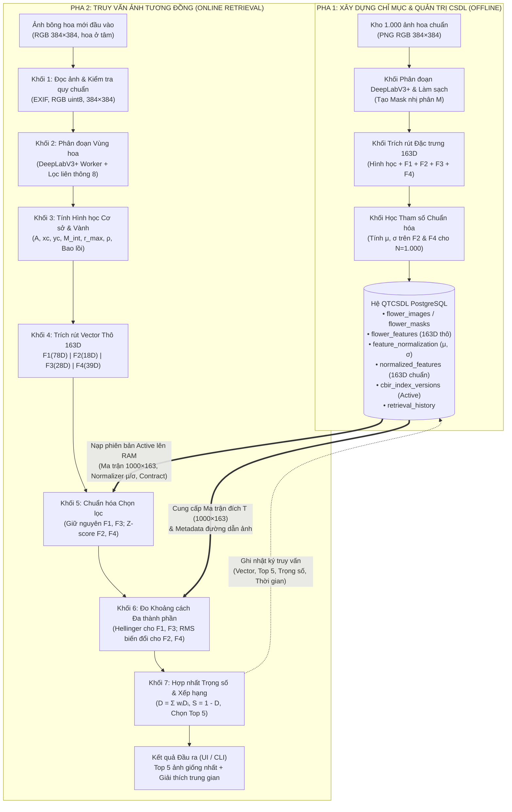
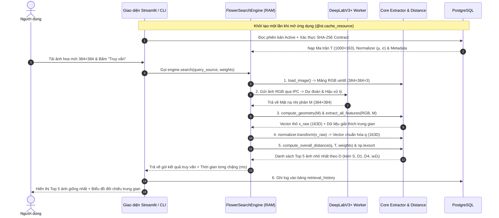

# BÁO CÁO KỸ THUẬT CÂU 4: XÂY DỰNG VÀ ĐÁNH GIÁ HỆ THỐNG TÌM KIẾM ẢNH BÔNG HOA TƯƠNG ĐỒNG THEO NỘI DUNG (CBIR)

**Học phần:** Hệ Cơ sở Dữ liệu Đa phương tiện  
**Đề tài:** Xây dựng hệ CSDL lưu trữ và tìm kiếm ảnh bông hoa  
**Nhóm môn học:** 03 — **Nhóm bài tập lớn:** 09  
**Giảng viên hướng dẫn:** Nguyễn Đình Hóa  
**Thành viên thực hiện:**
- B23DCCN554 — Nguyễn Công Minh
- B23DCCN736 — Nguyễn Hữu Tâm
- B23DCCN624 — Phạm Hồng Nhật

---

## MỤC LỤC

1. [Tổng quan mục tiêu và phạm vi của Hệ thống Tìm kiếm (Câu 4)](#1-tổng-quan-mục-tiêu-và-phạm-vi-của-hệ-thống-tìm-kiếm-câu-4)
2. [Phần 4a: Kiến trúc Sơ đồ khối, Chức năng từng Module và Quy trình hoạt động](#2-phần-4a-kiến-trúc-sơ-đồ-khối-chức-năng-từng-module-và-quy-trình-hoạt-động)
   - [2.1. Sơ đồ khối tổng thể của hệ thống](#21-sơ-đồ-khối-tổng-thể-của-hệ-thống)
   - [2.2. Đặc tả chức năng và Dữ liệu Vào/Ra của từng Khối/Module](#22-đặc-tả-chức-năng-và-dữ-liệu-vàora-của-từng-khốimodule)
   - [2.3. Hệ sinh thái Công cụ, Ngôn ngữ và Thư viện kỹ thuật sử dụng](#23-hệ-sinh-thái-công-cụ-ngôn-ngữ-và-thư-viện-kỹ-thuật-sử-dụng)
   - [2.4. Vai trò của các thành phần hỗ trợ ngoài phạm vi trọng tâm (DeepLabV3+, Hậu xử lý, CSDL)](#24-vai-trò-của-các-thành-phần-hỗ-trợ-ngoài-phạm-vi-trọng-tâm-deeplabv3-hậu-xử-lý-csdl)
   - [2.5. Cơ sở toán học và Cài đặt chi tiết các khối lõi: Trích rút 163D, Chuẩn hóa chọn lọc và Đo độ tương đồng](#25-cơ-sở-toán-học-và-cài-đặt-chi-tiết-các-khối-lõi-trích-rút-163d-chuẩn-hóa-chọn-lọc-và-đo-độ-tương-đồng)
   - [2.6. Quy trình thực hiện yêu cầu truy vấn từ đầu đến cuối (End-to-End Workflow)](#26-quy-trình-thực-hiện-yêu-cầu-truy-vấn-từ-đầu-đến-cuối-end-to-end-workflow)
3. [Phần 4b: Minh họa chi tiết các Kết quả Trung gian của Quá trình Truy vấn](#3-phần-4b-minh-họa-chi-tiết-các-kết-quả-trung-gian-của-quá-trình-truy-vấn)
   - [3.1. Thông tin ảnh truy vấn mẫu và Kết quả tách nền, hình học cơ sở](#31-thông-tin-ảnh-truy-vấn-mẫu-và-kết-quả-tách-nền-hình-học-cơ-sở)
   - [3.2. Giá trị đặc trưng thô trung gian trên 4 nhóm F1, F2, F3, F4 (163 chiều)](#32-giá-trị-đặc-trưng-thô-trung-gian-trên-4-nhóm-f1-f2-f3-f4-163-chiều)
   - [3.3. Biến đổi qua Bộ chuẩn hóa chọn lọc (Selective Z-score Normalization)](#33-biến-đổi-qua-bộ-chuẩn-hóa-chọn-lọc-selective-z-score-normalization)
   - [3.4. Minh họa tính toán khoảng cách thành phần, hợp nhất trọng số và xếp hạng Top 5](#34-minh-họa-tính-toán-khoảng-cách-thành-phần-hợp-nhất-trọng-số-và-xếp-hạng-top-5)
4. [Phần 4c: Đánh giá Kết quả Đạt được, Thực nghiệm Ablation và Nhận xét](#4-phần-4c-đánh-giả-kết-quả-đạt-được-thực-nghiệm-ablation-và-nhận-xét)
   - [4.1. Kiểm chứng tính đúng đắn và các bất biến toán học trên toàn kho 1.000 ảnh](#41-kiểm-chứng-tính-đúng-đắn-và-các-bất-biến-toán-học-trên-toàn-kho-1000-ảnh)
   - [4.2. Đánh giá thực nghiệm truy vấn trên các ảnh hoa mới ngoài CSDL](#42-đánh-giá-thực-nghiệm-truy-vấn-trên-các-ảnh-hoa-mới-ngoài-csdl)
   - [4.3. Nghiên cứu loại bỏ thành phần đặc trưng (Ablation Study)](#43-nghiên-cứu-loại-bỏ-thành-phần-đặc-trưng-ablation-study)
   - [4.4. Đánh giá hiệu năng thời gian phản hồi](#44-đánh-giá-hiệu-năng-thời-gian-phản-hồi)
   - [4.5. Ưu điểm, hạn chế thực tế và hướng phát triển](#45-ưu-điểm-hạn-chế-thực-tế-và-hướng-phát-triển)

---

## 1. TỔNG QUAN MỤC TIÊU VÀ PHẠM VI CỦA HỆ THỐNG TÌM KIẾM (CÂU 4)

Theo yêu cầu Câu 4 của đề bài, hệ thống tìm kiếm ảnh tương đồng theo nội dung (*Content-Based Image Retrieval — CBIR*) được xây dựng để giải quyết bài toán:
- **Đầu vào (Input):** Một tệp ảnh số mới chụp một bông hoa bất kỳ (có thể thuộc cùng loài hoặc khác loài với 1.000 ảnh đang lưu trữ trong CSDL), tuân thủ quy chuẩn bố cục đồng nhất của bộ dữ liệu: kích thước $384 \times 384$ pixel, hệ màu RGB, góc chụp trực diện từ trên xuống, gồm một bông hoa chính nằm tại trung tâm khung hình.
- **Đầu ra (Output):** Danh sách **Top 5 ảnh bông hoa giống nhất** trong kho 1.000 ảnh, được sắp xếp theo thứ tự giảm dần về độ tương đồng nội dung thị giác $S \in [0, 1]$ (tương ứng thứ tự tăng dần về khoảng cách tổng hợp $D$), kèm theo đầy đủ các chỉ số trung gian giải thích lý do xếp hạng.

**Nguyên tắc kiến trúc cốt lõi của hệ thống:**
1. **Đồng nhất tuyệt đối thuật toán giữa Pha Lưu trữ (Offline Indexing) và Pha Truy vấn (Online Querying):** Cả quá trình xây dựng kho 1.000 ảnh lẫn quá trình truy vấn ảnh mới đều gọi chung một thư viện lõi duy nhất (`flower_cbir/core/`). Không có sự sao chép hay viết lại công thức giữa bước nạp CSDL và bước tìm kiếm.
2. **Kiểm soát tính toàn vẹn bằng Hợp đồng trích rút (`Extraction Contract`):** Hệ thống lưu dấu vân tay mật mã SHA-256 của toàn bộ tệp mã nguồn thuật toán, cấu hình tham số, mô hình phân đoạn và phiên bản thư viện vào PostgreSQL. Trước mỗi phiên truy vấn, hệ thống tự động đối chiếu hợp đồng để bảo đảm vector của ảnh mới và 1.000 vector trong kho được sinh ra trong cùng một không gian biểu diễn toán học.
3. **Khả năng giải thích trắng (*White-box Explainability*):** Thay vì dùng một mạng học sâu hộp đen ánh xạ thẳng từ ảnh sang vector ẩn không thể diễn giải, hệ thống chỉ sử dụng học sâu (DeepLabV3+) cho nhiệm vụ tách nền vùng hoa, sau đó trích xuất tường minh **12 thuộc tính thị giác (163 chiều)** thuộc 4 nhóm Màu sắc tổng thể ($\mathbf{F}_1$), Phân bố màu theo vành ($\mathbf{F}_2$), Kết cấu bề mặt ($\mathbf{F}_3$) và Hình dạng – Cấu trúc nội bộ ($\mathbf{F}_4$) đúng theo thiết kế tại Báo cáo lần 1.

---

## 2. PHẦN 4A: KIẾN TRÚC SƠ ĐỒ KHỐI, CHỨC NĂNG TỪNG MODULE VÀ QUY TRÌNH HOẠT ĐỘNG

### 2.1. Sơ đồ khối tổng thể của hệ thống

Hệ thống được thiết kế theo kiến trúc phân tầng rõ ràng gồm hai luồng liên kết chặt chẽ thông qua Hệ quản trị CSDL PostgreSQL: **Luồng Xây dựng Chỉ mục Ngoại tuyến (Offline Indexing)** và **Luồng Truy vấn Trực tuyến (Online Retrieval)**.

---

### 2.2. Đặc tả chức năng và Dữ liệu Vào/Ra của từng Khối/Module

Bảng dưới đây trình bày chi tiết từng khối chức năng trong mã nguồn hệ thống, tệp cài đặt tương ứng, nhiệm vụ xử lý cũng như quy격 dữ liệu đầu vào và đầu ra của từng khối:

| TT | Tên Khối / Module | Tệp mã nguồn chính | Chức năng xử lý chính | Dữ liệu Đầu vào (Input) | Dữ liệu Đầu ra (Output) |
| :-: | :--- | :--- | :--- | :--- | :--- |
| **1** | **Khối Tiếp nhận & Tiền xử lý ảnh** | `flower_cbir/core/preprocess.py` | Giải mã tệp ảnh, hiệu chỉnh hướng xoay theo thẻ EXIF, chuyển đổi đồng nhất sang không gian màu RGB 8-bit (nếu ảnh có kênh Alpha RGBA thì ghép trên nền trắng), kiểm tra kích thước chuẩn $384 \times 384$. | Đường dẫn tệp ảnh hoặc chuỗi byte nhị phân (`JPG`, `JPEG`, `PNG`). | Mảng đa chiều `image_rgb` kiểu `uint8`, kích thước `(384, 384, 3)`. |
| **2** | **Khối Phân đoạn ngữ nghĩa & Hậu xử lý mặt nạ** | `flower_cbir/core/deeplab.py` `cau_3/cbir_deeplabv3plus_worker.py` `flower_cbir/core/segmentation.py` | Giao tiếp qua IPC (JSON-line stdin/stdout) tới tiến trình worker giữ sẵn mô hình **DeepLabV3+** trong bộ nhớ để tách vùng hoa khỏi hậu cảnh (lá, cành, đất); lấp lỗ hổng nhỏ và lọc giữ duy nhất thành phần liên thông lớn nhất theo lân cận 8. | Mảng `image_rgb` `(384, 384, 3)` kiểu `uint8`. | - Mặt nạ nhị phân `mask_binary` $M \in \{0, 255\}^{384 \times 384}$. - Ảnh minh họa tách nền `overlay` `(384, 384, 3)`. |
| **3** | **Khối Tính toán Hình học cơ sở & Phân vành** | `flower_cbir/core/geometry.py` | Xác định diện tích $A$, trọng tâm $(x_c, y_c)$, co mặt nạ bằng phần tử cấu trúc elip $B_5 (5 \times 5)$ tạo mặt nạ nội bộ $M_{\text{int}}$, tính bán kính tham chiếu $r_{\max}$, bản đồ bán kính chuẩn hóa $\rho(x, y)$, lập bản đồ 3/4/5 vành đồng tâm và trích đường bao ngoài chính (chu vi $P$, bao lồi, hộp bao xoay nhỏ nhất). | Mặt nạ nhị phân `mask_binary` `(384, 384)`. | Từ điển cấu trúc hình học `geom` chứa $A, A_{\text{int}}, (x_c, y_c), r_{\max}$, `rho_map`, các bản đồ vành (`f2_ring_map`, `iap_ring_map`, `iep_ring_map`), chu vi, diện tích bao lồi và cạnh hộp xoay. |
| **4** | **Khối Trích rút Đặc trưng Thị giác 163 chiều** | `flower_cbir/core/features.py` `flower_cbir/core/schema.py` | Tính toán tuần tự 4 nhóm đặc trưng trên vùng hoa: • $\mathbf{F}_1$ (78D): Histogram HSV H–S ($12\times 6$) và V ($6$). • $\mathbf{F}_2$ (18D): Trung bình & độ lệch chuẩn CIELAB trên 3 vành. • $\mathbf{F}_3$ (28D): Kết cấu $\text{LBP}_{8,1}^{\text{riu2}}$ và $\text{LBP}_{16,2}^{\text{riu2}}$. • $\mathbf{F}_4$ (39D): 4 tỷ số hình dạng, 12 hệ số Fourier tia, 16 chiều IAP, 7 chiều IEP. Kiểm tra tính hợp lệ (`validate_features`). | `image_rgb` `(384, 384, 3)` và cấu trúc hình học `geom`. | - Vector đặc trưng thô `raw_vector` $\mathbf{x} \in \mathbb{R}^{163}$ (`float32`). - Từ điển dữ liệu giải thích trung gian `explanation`. |
| **5** | **Khối Chuẩn hóa Chọn lọc (Selective Normalizer)** | `flower_cbir/core/normalization.py` | Đưa vector đặc trưng thô về không gian so sánh chung: bảo toàn nguyên vẹn phân phối xác suất của $\mathbf{F}_1, \mathbf{F}_3$; áp dụng chuẩn hóa Z-score ($z = \frac{x - \mu}{\sigma}$) cho $\mathbf{F}_2, \mathbf{F}_4$ dựa trên thống kê $(\boldsymbol{\mu}, \boldsymbol{\sigma})$ của 1.000 ảnh kho. | `raw_vector` $\mathbf{x} \in \mathbb{R}^{163}$ và tham số $(\boldsymbol{\mu}, \boldsymbol{\sigma}) \in \mathbb{R}^{163}$ của chỉ mục Active. | Vector truy vấn chuẩn hóa `norm_vector` $\mathbf{q} \in \mathbb{R}^{163}$ (`float32`). |
| **6** | **Khối Đo Khoảng cách & Xếp hạng Tương đồng** | `flower_cbir/core/distance.py` `flower_cbir/services/search.py` | Tính đồng thời (vector hóa ma trận) khoảng cách Hellinger cho $\mathbf{F}_1, \mathbf{F}_3$ và khoảng cách RMS biến đổi cho $\mathbf{F}_2, \mathbf{F}_4$ giữa $\mathbf{q}$ và toàn bộ ma trận đích $\mathbf{T} \in \mathbb{R}^{1000 \times 163}$. Hợp nhất theo bộ trọng số $(w_1, w_2, w_3, w_4)$, chuyển sang độ tương đồng $S = 1 - D$ và sắp xếp lấy Top 5. | Vector $\mathbf{q} \in \mathbb{R}^{163}$, ma trận kho $\mathbf{T} \in \mathbb{R}^{1000 \times 163}$, bộ trọng số $\mathbf{w}$. | Danh sách `results` gồm **Top 5 ảnh giống nhất** kèm điểm $S, D$, khoảng cách nhóm $D_1..D_4$, đóng góp $w_i D_i$ và 9 khoảng cách khối con. |
| **7** | **Khối Quản trị CSDL & Kiểm soát Phiên bản** | `flower_cbir/services/database.py` `flower_cbir/services/index_store.py` `flower_cbir/core/contract.py` | Quản lý phiên bản chỉ mục đang hoạt động (`active = TRUE`) trong PostgreSQL, kiểm tra chữ ký SHA-256 của mã nguồn và tệp ảnh/mask, nạp ma trận đặc trưng lên bộ nhớ RAM khi khởi động và ghi nhật ký truy vấn vào bảng `retrieval_history`. | Kết nối PostgreSQL, kết quả tìm kiếm Top 5 và thông tin phiên truy vấn. | Dữ liệu chỉ mục đã xác thực trên RAM (`index_data`) và bản ghi lịch sử lưu bền vững trong CSDL. |
| **8** | **Khối Giao diện Tương tác & Giải thích trực quan** | `flower_cbir/app.py` `main.py` | Cung cấp giao diện Web trực quan (Streamlit) và giao diện dòng lệnh (CLI) cho phép tải ảnh mới, điều chỉnh trọng số thực nghiệm (xếp hạng lại tức thì `rerank`), hiển thị Top 5, vẽ biểu đồ đối chiếu trung gian và chạy kiểm thử Ablation. | Tệp ảnh người dùng tải lên và thao tác tương tác trên giao diện. | Màn hình hiển thị trực quan Top 5 ảnh, mặt nạ, công thức tính toán, biểu đồ đối chiếu F1–F4 và lịch sử truy vấn. |

---

### 2.3. Hệ sinh thái Công cụ, Ngôn ngữ và Thư viện kỹ thuật sử dụng

Để bảo đảm tính chính xác số học, tốc độ phản hồi thời gian thực và khả năng tái lập kết quả giữa các môi trường, hệ thống sử dụng tổ hợp các công cụ và thư viện chuyên dụng trong hệ sinh thái Python khoa học dữ liệu:

1. **Ngôn ngữ lập trình Python (3.12 / 3.13):** Đóng vai trò ngôn ngữ phát triển thống nhất cho toàn bộ pipeline xử lý ảnh, trích rút đặc trưng, kết nối CSDL và giao diện người dùng.
2. **NumPy (`numpy >= 1.25`):** Thư viện nền tảng xử lý đại số tuyến tính và mảng đa chiều:
   - Lưu trữ toàn bộ vector đặc trưng ở định dạng chuẩn IEEE 754 `float32` (và tính trung bình/độ lệch chuẩn ở `float64` để tránh sai số tích lũy).
   - Thực hiện tính toán histogram một chiều/hai chiều (`np.histogram`, `np.histogram2d`), biến đổi Fourier nhanh rời rạc 1D (`np.fft.fft` cho đặc trưng $\mathbf{F}_{4.5}$), sắp xếp từ điển đa khóa (`np.lexsort`) và tính khoảng cách ma trận đồng loạt trên toàn bộ 1.000 vector không cần vòng lặp Python.
3. **OpenCV (`opencv-python >= 4.8`):** Thư viện thị giác máy tính tốc độ cao viết bằng C++ dùng cho các phép toán hình ảnh cốt lõi:
   - Chuyển đổi không gian màu chính xác trên số thực 32-bit: `cv2.cvtColor(..., cv2.COLOR_RGB2HSV)` cho $\mathbf{F}_1$ và `cv2.COLOR_RGB2Lab` cho $\mathbf{F}_2$.
   - Phân tích thành phần liên thông lân cận 8: `cv2.connectedComponentsWithStats(..., connectivity=8)`.
   - Phép co hình thái học tạo mặt nạ nội bộ $M_{\text{int}}$: `cv2.getStructuringElement(cv2.MORPH_ELLIPSE, (5, 5))` và `cv2.erode(..., borderValue=0)`.
   - Tính mô-men hình học tìm trọng tâm (`cv2.moments`), trích xuất đường bao ngoài (`cv2.findContours`), tính chu vi (`cv2.arcLength`), bao lồi (`cv2.convexHull`, `cv2.contourArea`) và hộp chữ nhật bao xoay diện tích nhỏ nhất (`cv2.minAreaRect`).
   - Tính đạo hàm bậc nhất Sobel $3 \times 3$ ở độ chính xác kép `cv2.CV_64F` cho đặc trưng IAP ($\mathbf{F}_{4.6}$); làm mịn Gaussian $5 \times 5$ (`cv2.GaussianBlur`) và dò cạnh Canny chuẩn Euclid (`cv2.Canny(..., L2gradient=True)`) cho đặc trưng IEP ($\mathbf{F}_{4.7}$).
4. **scikit-image (`scikit-image >= 0.22`):** Sử dụng hàm chuẩn học thuật `skimage.feature.local_binary_pattern(..., method='uniform')` để tính toán toán tử kết cấu đa bán kính bất biến xoay đồng nhất $\text{LBP}_{8,1}^{\text{riu2}}$ và $\text{LBP}_{16,2}^{\text{riu2}}$ với nội suy song tuyến tính chính xác trên đường tròn lấy mẫu.
5. **Pillow (`Pillow >= 10.0`):** Đọc tệp ảnh đa định dạng, xử lý siêu dữ liệu hướng chụp máy ảnh (`ImageOps.exif_transpose`) và kiểm tra định dạng lưu trữ không suy hao (`PNG`).
6. **PyTorch (`torch`):** Vận hành suy luận (*inference*) cho mô hình mạng nơ-ron tích chập phân đoạn vùng hoa **DeepLabV3+** trong một tiến trình worker độc lập (`cbir_deeplabv3plus_worker.py`) ở chế độ xác định (`model.eval()`, `torch.inference_mode()`).
7. **PostgreSQL & Psycopg 3 (`psycopg[binary] >= 3.3`):** Hệ quản trị CSDL quan hệ – đối tượng dùng lưu trữ bền vững siêu dữ liệu ảnh, các cột đặc trưng phân rã, tham số chuẩn hóa, phiên bản chỉ mục bất biến (kiểu `DOUBLE PRECISION[]`, `JSONB`, hỗ trợ mở rộng `pgvector`) và quản lý giao dịch nguyên tử ở mức cô lập `REPEATABLE READ`.
8. **Streamlit (`streamlit >= 1.30`) & Matplotlib (`matplotlib >= 3.8`):** Xây dựng ứng dụng web tương tác thời gian thực, quản lý bộ đệm bộ nhớ (`@st.cache_resource`) và kết xuất hệ thống biểu đồ giải thích các bước trung gian.
9. **Thư viện chuẩn `hashlib` (SHA-256):** Kiểm chứng tính toàn vẹn mức bit của tệp ảnh, mặt nạ, trọng số mô hình và mã nguồn thuật toán.

---

### 2.4. Vai trò của các thành phần hỗ trợ ngoài phạm vi trọng tâm (DeepLabV3+, Hậu xử lý, CSDL)

Trong khuôn khổ môn học *Hệ Cơ sở Dữ liệu Đa phương tiện*, trọng tâm cốt lõi của hệ thống tìm kiếm là biểu diễn đặc trưng nội dung, chuẩn hóa không gian vector, đo độ tương đồng và tổ chức truy vấn. Tuy nhiên, để hệ thống hoạt động tự động và chính xác trên ảnh chụp tự nhiên, hai thành phần hỗ trợ đóng vai trò nền tảng không thể thiếu:

#### a. Mô hình phân đoạn ngữ nghĩa DeepLabV3+ và Bộ lọc hậu xử lý mặt nạ
- **Lý do cần thiết và Tác dụng trong hệ thống:** Ảnh chụp hoa thực tế luôn chứa hậu cảnh phức tạp (lá xanh, cành cây, đất, sỏi hoặc bóng tối). Nếu trích xuất màu sắc hay kết cấu trên toàn bộ bức ảnh $384 \times 384$, màu xanh của lá và các cạnh gân lá ở nền sẽ làm nhiễu loạn hoàn toàn vector đặc trưng, khiến hai ảnh có cùng nền lá xanh bị xếp gần nhau dù bông hoa khác hẳn nhau. Mô hình **DeepLabV3+** đóng vai trò "bộ lọc thị giác đầu nguồn", tự động tách riêng các pixel thuộc bông hoa chính ($M=1$) khỏi hậu cảnh ($M=0$) cho cả 1.000 ảnh trong kho lẫn mọi ảnh truy vấn mới đưa vào.
- **Cách tích hợp kỹ thuật:** Mô hình DeepLabV3+ (đầu vào và đầu ra trực tiếp ở độ phân giải $384 \times 384$) được chạy trong một tiến trình nền độc lập (`cbir_deeplabv3plus_worker.py`), giữ sẵn trọng số trong RAM để không phải khởi tạo lại mỗi lần bấm tìm kiếm. Bản đồ xác suất đầu ra đi qua ngưỡng `threshold = 0.45`, bộ hậu xử lý (`fill_holes` lấp lỗ nhỏ $\le 20$ px, `repair_center` bảo toàn vùng nhụy tối màu ở tâm, `keep_nearby`) và cuối cùng đi qua hàm chuẩn hóa chung `clean_mask()` giữ lại duy nhất **thành phần liên thông lớn nhất theo lân cận 8** đúng như quy ước tại Báo cáo lần 1.
- **Kết quả đạt được của khâu phân đoạn:** Mô hình được tinh chỉnh (*fine-tuned*) trên bộ mặt nạ chuẩn đã rà soát của tập dữ liệu hoa $384 \times 384$, đạt chỉ số giao trên hợp trung bình **Validation mIoU = 95,64%** (và tới **98,50%** trên cấu hình kiểm định mở rộng `final_segmentation_v2`, **95,61%** trên tập kiểm tra độc lập sửa tay). Thời gian suy luận trung bình trên CPU chỉ khoảng **~150 – 200 ms/ảnh**, tách rất sát mép cánh hoa và bảo toàn tốt phần nhụy sẫm màu ở giữa bông.

#### b. Tổ chức lưu trữ và nạp chỉ mục Active từ Hệ QTCSDL PostgreSQL
- **Tác dụng trong hệ thống tìm kiếm:** CSDL PostgreSQL đóng vai trò nguồn chân lý duy nhất (*Single Source of Truth*) lưu trữ toàn bộ 1.000 ảnh kho trên hệ thống bảng quan hệ chuẩn hóa (`flower_images`, `flower_masks`, `flower_features`, `feature_normalization`, `normalized_features`, `cbir_index_versions`, `cbir_index_entries` và `retrieval_history`).
- **Cơ chế Phiên bản Chỉ mục Đang hoạt động (*Active Index*) và Bộ đệm RAM:** Trong bảng `cbir_index_versions`, chỉ có duy nhất một phiên bản chỉ mục đã vượt qua kiểm tra đối chiếu bit-level mới được bật cờ `active = TRUE` (hiện tại là phiên bản `report1-163-v3-56a7227bb1b6b62e4db2`). Khi khởi chạy `FlowerSearchEngine`, hệ thống xác thực chữ ký `contract` rồi nạp toàn bộ 1.000 vector chuẩn hóa $(1000 \times 163)$ cùng vector tham số $(\boldsymbol{\mu}, \boldsymbol{\sigma})$ từ PostgreSQL lên bộ nhớ RAM. Nhờ kiến trúc kết hợp "lưu trữ bền vững có kiểm soát giao dịch dưới PostgreSQL + quét ma trận NumPy trên RAM", hệ thống vừa đảm bảo an toàn dữ liệu tuyệt đối, vừa đạt tốc độ so khớp 1.000 ảnh dưới **1 mili-giây**.

---

### 2.5. Cơ sở toán học và Cài đặt chi tiết các khối lõi: Trích rút 163D, Chuẩn hóa chọn lọc và Đo độ tương đồng

Đây là phần trái tim của hệ thống CBIR, thực thi chính xác tuyệt đối các công thức toán học đã xây dựng tại **Báo cáo lần 1** và bổ sung cơ chế chuẩn hóa chọn lọc cùng hàm đo độ tương đồng đa thành phần cho Câu 4.

#### 2.5.1. Biểu diễn hình học cơ sở và Phân chia vành đồng tâm (`geometry.py`)
Cho ảnh màu RGB $I \in \{0, \dots, 255\}^{384 \times 384 \times 3}$ và mặt nạ vùng hoa nhị phân $M(x, y) \in \{0, 1\}$ (sau khi đã giữ thành phần liên thông lớn nhất theo lân cận 8). Hằng số bảo vệ mẫu số được cố định trên toàn hệ thống là $\epsilon = 10^{-12}$.

1. **Diện tích vùng hoa $A$ và Trọng tâm hình học $(x_c, y_c)$:**
   $$A = |M| = \sum_{y=0}^{383} \sum_{x=0}^{383} M(x, y), \qquad x_c = \frac{1}{A}\sum_{(x,y)\in M} x, \qquad y_c = \frac{1}{A}\sum_{(x,y)\in M} y$$
   Trong cài đặt, hệ thống tính thông qua mô-men bậc không và bậc nhất `cv2.moments(mask_binary)` ($x_c = m_{10}/m_{00}, y_c = m_{01}/m_{00}$), từ chối ngay các mặt nạ suy biến có $A = 0$.

2. **Mặt nạ vùng hoa nội bộ $M_{\text{int}}$:**
   Để ngăn chặn đường biên cắt giữa rìa cánh hoa và nền ảnh tạo ra gradient/cạnh nhân tạo khi phân tích cấu trúc bên trong hoa, mặt nạ $M$ được xói mòn (*erosion*) 1 lần bởi phần tử cấu trúc hình elip $B_5$ kích thước $5 \times 5$ với giá trị ngoài biên bằng $0$:
   $$M_{\text{int}} = M \ominus B_5, \qquad A_{\text{int}} = |M_{\text{int}}| > 0$$

3. **Khoảng cách tâm $d_c(x,y)$, Bán kính tham chiếu $r_{\max}$ và Bán kính chuẩn hóa $\rho(x,y)$:**
   $$d_c(x, y) = \sqrt{(x - x_c)^2 + (y - y_c)^2}, \qquad r_{\max} = \max_{(x,y) \in M_{\text{int}}} d_c(x, y), \qquad \rho(x, y) = \frac{d_c(x, y)}{r_{\max}}$$
   *(Nếu $r_{\max} \le \epsilon$, gán $r_{\max} = 1.0$). Trên $M_{\text{int}}$, ta luôn có $0 \le \rho(x,y) \le 1$; một số điểm sát mép ngoài thuộc $M \setminus M_{\text{int}}$ có $\rho > 1$ sẽ được gộp vào vành ngoài cùng nhờ hàm $\min$).*

4. **Các đại lượng đường bao ngoài chính (`main_contour`):**
   Sử dụng `cv2.findContours` với chế độ `RETR_EXTERNAL` và `CHAIN_APPROX_NONE` (giữ toàn bộ điểm biên liên tục), chọn đường bao có diện tích lớn nhất để trích:
   - Chu vi đường bao khép kín: $P = \text{arcLength}(\text{contour}, \text{True})$.
   - Diện tích đa giác bao lồi nhỏ nhất: $A_{\text{convex}} = \text{contourArea}(\text{convexHull}(\text{contour}))$.
   - Hai cạnh của hình chữ nhật bao xoay diện tích nhỏ nhất (`minAreaRect`): $L_{\text{major}} = \max(w_{\text{rect}}, h_{\text{rect}})$ và $L_{\text{minor}} = \min(w_{\text{rect}}, h_{\text{rect}})$.

---

#### 2.5.2. Thuật toán trích rút 4 nhóm đặc trưng tạo Vector 163 chiều (`features.py`)

Vector đặc trưng tổng hợp $\mathbf{F}(I) \in \mathbb{R}^{163}$ được ghép nối theo thứ tự cố định:
$$\mathbf{F}(I) = \left[ \underbrace{\mathbf{F}_1(I)^T}_{78\text{ chiều}} \,\middle|\, \underbrace{\mathbf{F}_2(I)^T}_{18\text{ chiều}} \,\middle|\, \underbrace{\mathbf{F}_3(I)^T}_{28\text{ chiều}} \,\middle|\, \underbrace{\mathbf{F}_4(I)^T}_{39\text{ chiều}} \right]^T$$

##### Nhóm 1 — Đặc trưng màu sắc tổng thể $\mathbf{F}_1$ (`[0:78]` — 78 chiều):
- Chuẩn hóa ảnh RGB sang số thực $[0, 1]$ bằng phép chia cho $255.0$, chuyển sang không gian màu HSV qua `cv2.cvtColor(rgb_f32, cv2.COLOR_RGB2HSV)` thu được $H \in [0^\circ, 360^\circ)$ (bảo đảm tuần hoàn bằng `np.mod(H, 360.0)`), $S \in [0, 1]$ và $V \in [0, 1]$, chỉ lấy các pixel thuộc vùng hoa $M$.
- **Histogram 2D Sắc độ – Độ bão hòa ($\widehat{h}_{HS}$, 72 chiều `[0:72]`):** Chia đều miền $H$ thành $12$ khoảng (mỗi khoảng $30^\circ$) và miền $S$ thành $6$ khoảng (mỗi khoảng $1/6$, khoảng cuối đóng bên phải chứa cả giá trị $1.0$). Đếm số lượng pixel rơi vào từng ô $(i, j)$ với $i \in \{0..11\}, j \in \{0..5\}$, chia cho tổng diện tích $A$ để được phân phối xác suất $\sum_{i,j} \widehat{h}_{HS}(i,j) = 1$, rồi trải phẳng theo thứ tự ưu tiên hàng (*row-major*: chỉ số phẳng $k = 6i + j$).
- **Histogram 1D Độ sáng ($\widehat{h}_V$, 6 chiều `[72:78]`):** Chia đều miền $V \in [0, 1]$ thành $6$ khoảng trên tập pixel thuộc $M$ và chuẩn hóa riêng biệt sao cho $\sum_{i=0}^5 \widehat{h}_V(i) = 1$.

##### Nhóm 2 — Đặc trưng phân bố màu theo vị trí $\mathbf{F}_2$ (`[78:96]` — 18 chiều):
- Chuyển ảnh số thực RGB $[0, 1]$ sang không gian màu đồng nhất cảm nhận **CIELAB** ($L^* \in [0, 100], a^*, b^*$) bằng `cv2.cvtColor(rgb_f32, cv2.COLOR_RGB2Lab)`.
- Chia vùng hoa $M$ thành **3 vành bán kính đồng tâm** (tâm, giữa, ngoài):
  $$\Omega_r = \left\{ (x, y) \in M : \min\left(\lfloor 3\rho(x, y) \rfloor, 2\right) = r - 1 \right\}, \qquad r \in \{1, 2, 3\}$$
- Trên từng vành $\Omega_r$ có $N_r = |\Omega_r| > 0$, tính trung bình $\mu_{c, r}$ và độ lệch chuẩn tổng thể $\sigma_{c, r}$ (`ddof=0`, hệ số $1/N_r$) cho từng kênh $c \in \{L^*, a^*, b^*\}$:
  $$\mu_{c, r} = \frac{1}{N_r}\sum_{(x,y)\in \Omega_r} c(x,y), \qquad \sigma_{c, r} = \sqrt{\frac{1}{N_r}\sum_{(x,y)\in \Omega_r} \left[c(x,y) - \mu_{c,r}\right]^2}$$
  *(Nếu vành rỗng $N_r = 0$, quy ước cả 6 thống kê của vành bằng $0$).*
- Sắp xếp mỗi vành theo đúng thứ tự $[\mu_{L^*,r}, \sigma_{L^*,r}, \mu_{a^*,r}, \sigma_{a^*,r}, \mu_{b^*,r}, \sigma_{b^*,r}]$ rồi nối 3 vành từ trong ra ngoài ($3 \times 6 = 18$ chiều).

##### Nhóm 3 — Đặc trưng kết cấu bề mặt đa bán kính $\mathbf{F}_3$ (`[96:124]` — 28 chiều):
- Chuyển ảnh RGB gốc sang ảnh đa mức xám 8-bit `gray` bằng `cv2.cvtColor(image_rgb, cv2.COLOR_RGB2GRAY)`.
- Áp dụng toán tử **Local Binary Pattern đồng nhất bất biến xoay** ($\text{LBP}_{P, R}^{\text{riu2}}$) trên **toàn bộ ảnh xám** (lấy mẫu nội suy song tuyến tính trên đường tròn), sau đó chỉ thu thập mã của những pixel trung tâm nằm trong vùng hoa $M$:
  $$\text{LBP}_{P, R}^{\text{riu2}} = \begin{cases} \sum_{p=0}^{P-1} s(g_p - g_c), & \text{nếu } U(\text{LBP}_{P,R}) \le 2 \\ P + 1, & \text{nếu } U(\text{LBP}_{P,R}) > 2 \end{cases}, \qquad s(u) = \begin{cases} 1, & u \ge 0 \\ 0, & u < 0 \end{cases}$$
  với $U$ là số lần chuyển bit $0 \leftrightarrow 1$ quanh vòng tròn $P$ điểm.
- Trích xuất ở hai tỷ lệ không gian và chuẩn hóa xác suất từng histogram riêng biệt (tổng bằng $1$):
  1. Cấu hình $(P=8, R=1)$: sinh ra $P + 2 = 10$ nhãn $\{0, \dots, 9\}$ (`[96:106]`).
  2. Cấu hình $(P=16, R=2)$: sinh ra $P + 2 = 18$ nhãn $\{0, \dots, 17\}$ (`[106:124]`).

##### Nhóm 4 — Đặc trưng hình dạng và cấu trúc nội bộ $\mathbf{F}_4$ (`[124:163]` — 39 chiều):
Gồm 4 khối thành phần bổ trợ lẫn nhau giữa đường bao ngoài và tổ chức chi tiết bên trong:
1. **Bốn tỷ số hình dạng tổng quát (`scalars`, `[124:128]` — 4 chiều):**
   $$\mathcal{C}_{\text{circ}} = \text{clip}\left(\frac{4\pi A}{P^2 + \epsilon}, 0, 1\right), \qquad \mathcal{S}_{\text{solid}} = \text{clip}\left(\frac{A}{A_{\text{convex}} + \epsilon}, 0, 1\right)$$
   $$\mathcal{AR} = \frac{L_{\text{major}}}{L_{\text{minor}} + \epsilon}, \qquad \mathcal{RE} = \text{clip}\left(\frac{A}{L_{\text{major}}L_{\text{minor}} + \epsilon}, 0, 1\right)$$
2. **Phổ bán kính Fourier (`fourier`, `[128:140]` — 12 chiều):**
   Xuất phát từ trọng tâm $(x_c, y_c)$, phát $N = 128$ tia đều góc $\theta_n = \frac{2\pi n}{128}$ ($n = 0..127$). Trên mỗi tia, lấy mẫu khoảng cách rời rạc với bước nhảy $0.25$ pixel tới giới hạn đường chéo ảnh, làm tròn tọa độ $(\text{round}(x_c + r\cos\theta_n), \text{round}(y_c + r\sin\theta_n))$ về lưới nguyên và ghi nhận khoảng cách xa nhất $r[n]$ vẫn còn nằm trong mặt nạ $M$ (nếu không gặp pixel hoa thì $r[n] = 0$). Thực hiện biến đổi DFT 128 điểm (`np.fft.fft`) và chuẩn hóa theo thành phần một chiều $|R[0]|$ để đạt tính bất biến quay và tỷ lệ:
   $$R[k] = \sum_{n=0}^{127} r[n]\,e^{-i 2\pi k n / 128}, \qquad S[k] = \begin{cases} |R[k]| / |R[0]|, & |R[0]| > \epsilon \\ 0, & |R[0]| \le \epsilon \end{cases}, \quad k = 1, \dots, 12$$
3. **Mô hình góc nội bộ — IAP (`iap`, `[140:156]` — 16 chiều):**
   - Tính đạo hàm Sobel $3 \times 3$ (`gx`, `gy`) trên toàn ảnh xám gốc; suy ra biên độ $G(x,y) = \sqrt{g_x^2 + g_y^2}$ và góc gradient không định hướng $\theta_G(x,y) = \text{atan2}(g_y, g_x) \bmod 180^\circ$.
   - Tính góc tia bán kính từ trọng tâm $\varphi(x,y) = \text{atan2}(y - y_c, x - x_c) \bmod 180^\circ$ (quy ước $\varphi = 0$ nếu $d_c < \epsilon$) và góc tương đối $\psi(x,y) = (\theta_G(x,y) - \varphi(x,y)) \bmod 180^\circ$.
   - Lượng tử hóa $\psi$ vào $4$ khoảng hướng rộng $45^\circ$ đối xứng quanh $0^\circ, 45^\circ, 90^\circ, 135^\circ$:
     $$b(\psi) = \left\lfloor \frac{(\psi + 22.5^\circ) \bmod 180^\circ}{45^\circ} \right\rfloor \in \{0, 1, 2, 3\}$$
   - Chia mặt nạ nội bộ $M_{\text{int}}$ thành $4$ vành bán kính $\mathcal{A}_r = \{(x,y)\in M_{\text{int}} : \min(\lfloor 4\rho \rfloor, 3) = r\}$ ($r = 0..3$). Tích lũy tổng độ lớn gradient $E(r, m) = \sum_{(x,y)\in \mathcal{A}_r, b(\psi)=m} G(x,y)$ và chuẩn hóa tỷ lệ theo từng vành:
     $$f_{\text{IAP}}^{(r)}[m] = \frac{E(r, m)}{\sum_{u=0}^3 E(r, u) + \epsilon}, \qquad r \in \{0..3\},\; m \in \{0..3\}$$
     Trải phẳng 4 vành từ trong ra ngoài thu được $4 \times 4 = 16$ chiều.
4. **Cấu hình mật độ cạnh nội bộ — IEP (`iep`, `[156:163]` — 7 chiều):**
   - Làm mịn toàn ảnh xám bằng bộ lọc Gaussian $5 \times 5$ ($\sigma = 1.0$), dò cạnh nhị phân bằng thuật toán Canny với cặp ngưỡng $(50, 150)$, Sobel $3 \times 3$, chuẩn độ lớn Euclid (`L2gradient=True`), rồi lọc giữ các điểm cạnh nằm trong $M_{\text{int}}$ tạo $E_{\text{int}}(x,y) \in \{0, 1\}$.
   - Chia $M_{\text{int}}$ thành $5$ vành bán kính $\mathcal{B}_k = \{(x,y)\in M_{\text{int}} : \min(\lfloor 5\rho \rfloor, 4) = k - 1\}$ ($k = 1..5$) và tính mật độ cạnh trên từng vành:
     $$d_k = \frac{\sum_{(x,y)\in \mathcal{B}_k} E_{\text{int}}(x,y)}{|\mathcal{B}_k| + \epsilon}, \qquad k = 1, \dots, 5$$
   - Đặt $\bar{d} = \frac{1}{5}\sum_{k=1}^5 d_k$, tính thêm độ dốc hồi quy tuyến tính $S_{\text{edge}}$ từ tâm ra cánh và hệ số biến thiên $CV_{\text{edge}}$:
     $$S_{\text{edge}} = \frac{1}{10}\sum_{k=1}^5 (k - 3) d_k, \qquad CV_{\text{edge}} = \frac{\sqrt{\frac{1}{5}\sum_{k=1}^5 (d_k - \bar{d})^2}}{\bar{d} + \epsilon}$$
   - Ghép $[d_1, d_2, d_3, d_4, d_5, S_{\text{edge}}, CV_{\text{edge}}]^T$ thành 7 chiều cuối cùng.

---

#### 2.5.3. Chuẩn hóa chọn lọc — Selective Z-score Normalization (`normalization.py`)

Một vấn đề kinh điển trong CBIR đa đặc trưng là sự lệch thang đo nghiêm trọng giữa các thuộc tính:
- Các chiều thuộc $\mathbf{F}_1$ (`[0:78]`) và $\mathbf{F}_3$ (`[96:124]`) bản chất là **phân phối xác suất rời rạc** ($p_i \ge 0, \sum p_i = 1$). Nếu áp dụng chuẩn hóa Z-score lên các bin histogram này, các giá trị xác suất sẽ xuất hiện số âm (làm mất nghĩa khoảng cách Hellinger) và các bin màu hiếm có phương sai cực nhỏ $\sigma_i \approx 0$ sẽ bị phóng đại nhiễu lên hàng chục lần.
- Ngược lại, các chiều thuộc $\mathbf{F}_2$ (`[78:96]`) và $\mathbf{F}_4$ (`[124:163]`) là **các đại lượng vật lý/hình học không đồng nhất đơn vị**: giá trị $L^*, a^*, b^*$ nằm trong khoảng $[-80, +100]$, tỷ số khung hình $\mathcal{AR} \ge 1$, trong khi mật độ cạnh $d_k \in [0, 0.25]$ hay biên độ Fourier bậc cao $S[k] \approx 0.01$. Nếu không chuẩn hóa Z-score, kênh màu Lab (biên độ hàng chục đơn vị) sẽ lấn át hoàn toàn các đặc trưng hình học tinh tế.

Do đó, lớp `SelectiveNormalizer` thiết lập quy tắc **Chuẩn hóa chọn lọc** trên ma trận kho $\mathbf{X} \in \mathbb{R}^{N \times 163}$ ($N = 1.000$):
1. Trên tập chỉ số histogram $\mathcal{I}_{\text{hist}} = [0..77] \cup [96..123]$ (gồm 106 chiều của $\mathbf{F}_1$ và $\mathbf{F}_3$), đặt cố định tham số đồng nhất:
   $$\mu_j = 0, \qquad \sigma_j = 1 \qquad (\forall j \in \mathcal{I}_{\text{hist}})$$
2. Trên tập chỉ số thống kê và cấu trúc $\mathcal{I}_{\text{stat}} = [78..95] \cup [124..162]$ (gồm 57 chiều của $\mathbf{F}_2$ và $\mathbf{F}_4$), ước lượng kỳ vọng mẫu và độ lệch chuẩn tổng thể (`ddof=0`) trên $N = 1.000$ ảnh kho:
   $$\mu_j = \frac{1}{N}\sum_{n=1}^{N} X_{n, j}, \qquad s_j = \sqrt{\frac{1}{N}\sum_{n=1}^{N} (X_{n, j} - \mu_j)^2}, \qquad \sigma_j = \begin{cases} s_j, & s_j > \epsilon \\ 1.0, & s_j \le \epsilon \end{cases}$$
3. Mọi vector đặc trưng (cả vector kho lẫn vector ảnh truy vấn mới $\mathbf{x}$) đều được ánh xạ bằng cùng một phép biến đổi tuyến tính:
   $$z_j = \frac{x_j - \mu_j}{\sigma_j}, \qquad j = 0, 1, \dots, 162$$
   Nhờ vậy, $\mathbf{F}_1$ và $\mathbf{F}_3$ giữ nguyên tính chất phân phối xác suất chuẩn tắc, trong khi mọi chiều của $\mathbf{F}_2$ và $\mathbf{F}_4$ đều có trung bình bằng $0$ và phương sai bằng $1$ trên kho dữ liệu.

---

#### 2.5.4. Hàm đo khoảng cách đa thành phần và Độ tương đồng tổng hợp (`distance.py`)

Cho vector truy vấn đã chuẩn hóa $\mathbf{q} \in \mathbb{R}^{163}$ và một vector đích trong kho $\mathbf{t} \in \mathbb{R}^{163}$. Để mọi khoảng cách thành phần đều nằm chung trong miền bị chặn $[0, 1]$ trước khi kết hợp tuyến tính, hệ thống sử dụng hai họ hàm khoảng cách chuyên biệt phù hợp với bản chất toán học của từng nhóm:

1. **Khoảng cách Hellinger cho các phân phối xác suất ($\mathbf{F}_1$ và $\mathbf{F}_3$):**
   Với hai phân phối xác suất rời rạc $\mathbf{p}, \mathbf{u}$ ($\sum p_i = \sum u_i = 1, p_i, u_i \ge 0$), khoảng cách Hellinger là một metric thỏa mãn bất đẳng thức tam giác và luôn bị chặn chặt trong đoạn $[0, 1]$:
   $$H(\mathbf{p}, \mathbf{u}) = \sqrt{\frac{1}{2}\sum_{i} \left(\sqrt{p_i} - \sqrt{u_i}\right)^2} \in [0, 1]$$
   - **Khoảng cách nhóm $\mathbf{F}_1$ ($D_1$):** Trung bình cộng khoảng cách Hellinger của hai phân phối độc lập H–S (`[0:72]`) và V (`[72:78]`):
     $$D_1(\mathbf{q}, \mathbf{t}) = \frac{1}{2}\Big( H(\mathbf{q}_{[0:72]}, \mathbf{t}_{[0:72]}) + H(\mathbf{q}_{[72:78]}, \mathbf{t}_{[72:78]}) \Big) \in [0, 1]$$
   - **Khoảng cách nhóm $\mathbf{F}_3$ ($D_3$):** Trung bình cộng khoảng cách Hellinger của hai phân phối kết cấu $\text{LBP}_{8,1}$ (`[96:106]`) và $\text{LBP}_{16,2}$ (`[106:124]`):
     $$D_3(\mathbf{q}, \mathbf{t}) = \frac{1}{2}\Big( H(\mathbf{q}_{[96:106]}, \mathbf{t}_{[96:106]}) + H(\mathbf{q}_{[106:124]}, \mathbf{t}_{[106:124]}) \Big) \in [0, 1]$$

2. **Khoảng cách Căn trung bình bình phương biến đổi — Transformed RMS ($\mathbf{F}_2$ và $\mathbf{F}_4$):**
   Với hai vector con đã chuẩn hóa Z-score $\mathbf{a}, \mathbf{b} \in \mathbb{R}^K$, trước hết tính khoảng cách RMS (*Root Mean Square*, chia cho số chiều $K$ để loại bỏ sự thiên lệch do số lượng chiều khác nhau giữa các khối con):
   $$R(\mathbf{a}, \mathbf{b}) = \sqrt{\frac{1}{K}\sum_{i=1}^{K} (a_i - b_i)^2} \in [0, +\infty)$$
   Sau đó, áp dụng ánh xạ đơn điệu tăng nghiêm ngặt $T(R) = \frac{R}{1 + R}$ để nén miền giá trị không giới hạn $[0, +\infty)$ vào nửa khoảng $[0, 1)$ (giữ tính chất $T(0) = 0$; khi hai vector lệch nhau đúng $1$ độ lệch chuẩn trung bình $R = 1$ thì $T = 0.5$):
   $$T(\mathbf{a}, \mathbf{b}) = \frac{R(\mathbf{a}, \mathbf{b})}{1 + R(\mathbf{a}, \mathbf{b})} \in [0, 1)$$
   - **Khoảng cách nhóm $\mathbf{F}_2$ ($D_2$):** Tính trực tiếp trên khối 18 chiều màu Lab theo 3 vành (`[78:96]`):
     $$D_2(\mathbf{q}, \mathbf{t}) = T(\mathbf{q}_{[78:96]}, \mathbf{t}_{[78:96]}) \in [0, 1)$$
   - **Khoảng cách nhóm $\mathbf{F}_4$ ($D_4$):** Vì nhóm $\mathbf{F}_4$ gồm 4 khối con có số chiều rất chênh lệch (4 tỷ số vô hướng, 12 phổ Fourier, 16 chiều IAP, 7 chiều IEP), nếu gộp chung 39 chiều tính 1 lần RMS thì 16 chiều IAP và 12 chiều Fourier sẽ chiếm tới $28/39 \approx 72\%$ phương sai, làm mờ vai trò của 4 tỷ số hình dạng cơ bản. Do đó, hệ thống tính $T$ riêng cho từng khối con rồi lấy trung bình cộng đều 4 khối:
     $$D_4(\mathbf{q}, \mathbf{t}) = \frac{1}{4}\Big( \underbrace{T(\mathbf{q}_{[124:128]}, \mathbf{t}_{[124:128]})}_{d_{4,\text{scalars}}} + \underbrace{T(\mathbf{q}_{[128:140]}, \mathbf{t}_{[128:140]})}_{d_{4,\text{fourier}}} + \underbrace{T(\mathbf{q}_{[140:156]}, \mathbf{t}_{[140:156]})}_{d_{4,\text{iap}}} + \underbrace{T(\mathbf{q}_{[156:163]}, \mathbf{t}_{[156:163]})}_{d_{4,\text{iep}}} \Big) \in [0, 1)$$

3. **Khoảng cách kết hợp có trọng số $D(\mathbf{q}, \mathbf{t})$ và Độ tương đồng $S(\mathbf{q}, \mathbf{t})$:**
   Với bộ trọng số không âm $\mathbf{w} = (w_1, w_2, w_3, w_4)$ thỏa mãn $w_i \ge 0$ và $\sum_{i=1}^4 w_i = 1$ (cấu hình chuẩn của pipeline là $w_1 = 0.05, w_2 = 0.30, w_3 = 0.20, w_4 = 0.45$):
   $$D(\mathbf{q}, \mathbf{t}) = w_1 D_1(\mathbf{q}, \mathbf{t}) + w_2 D_2(\mathbf{q}, \mathbf{t}) + w_3 D_3(\mathbf{q}, \mathbf{t}) + w_4 D_4(\mathbf{q}, \mathbf{t}) \in [0, 1]$$
   Độ tương đồng nội dung thị giác được xác định trực tiếp bằng phần bù:
   $$S(\mathbf{q}, \mathbf{t}) = \text{clip}\big(1 - D(\mathbf{q}, \mathbf{t}),\, 0,\, 1\big) \in [0, 1]$$
   Khi hai bức ảnh có biểu diễn trùng khít nhau ($\mathbf{q} = \mathbf{t}$), ta có $D_1 = D_2 = D_3 = D_4 = 0 \implies D = 0$ và độ tương đồng đạt cực đại $S = 1.0$ ($100\%$).

---

### 2.6. Quy trình thực hiện yêu cầu truy vấn từ đầu đến cuối (End-to-End Workflow)

Quy trình vận hành thực tế của hệ thống khi xử lý một yêu cầu tìm kiếm diễn ra qua **6 bước tuần tự chặt chẽ**:

1. **Bước 1 — Khởi tạo và Đồng bộ không gian chỉ mục:** Khi khởi động ứng dụng, `FlowerDatabase.load_index()` mở giao dịch chỉ đọc `REPEATABLE READ` xuống PostgreSQL, kiểm tra chữ ký `verify_contract()`, kiểm tra mã băm SHA-256 của toàn bộ 1.000 ảnh/mặt nạ trên đĩa và nạp ma trận đặc trưng chuẩn hóa $\mathbf{T} \in \mathbb{R}^{1000 \times 163}$ cùng bộ chuẩn hóa `SelectiveNormalizer` lên RAM.
2. **Bước 2 — Đọc và kiểm tra ảnh đầu vào:** Người dùng tải lên một tệp ảnh bông hoa mới. Hàm `load_image()` giải mã ảnh, chuẩn hóa hướng EXIF, đưa về hệ màu `uint8 RGB` và xác nhận kích thước đúng $384 \times 384$ pixel.
3. **Bước 3 — Tách nền bông hoa tự động:** Ảnh RGB được chuyển tới `DeepLabSegmenter`. Worker DeepLabV3+ dự đoán xác suất vùng hoa, lọc hậu xử lý và hàm `clean_mask()` giữ lại thành phần liên thông 8 lớn nhất tạo mặt nạ $M$, đồng thời kết xuất ảnh `overlay` viền xanh lá phục vụ kiểm tra trực quan.
4. **Bước 4 — Trích rút đặc trưng 163 chiều và tín hiệu giải thích:** Hàm `extract_all_features()` gọi `compute_geometry()` để dựng tâm, $M_{\text{int}}$, các bản đồ vành đồng tâm, sau đó trích xuất tuần tự $\mathbf{F}_1 (78\text{D}), \mathbf{F}_2 (18\text{D}), \mathbf{F}_3 (28\text{D}), \mathbf{F}_4 (39\text{D})$ tạo vector thô $\mathbf{x}_{\text{raw}} \in \mathbb{R}^{163}$ và kiểm tra các bất biến xác suất qua `validate_features()`.
5. **Bước 5 — Chuẩn hóa chọn lọc và So khớp ma trận:** Vector $\mathbf{x}_{\text{raw}}$ đi qua `normalizer.transform()` thành vector $\mathbf{q} \in \mathbb{R}^{163}$. Tiếp đó, `compute_overall_distance()` thực hiện phép toán ma trận NumPy tính đồng thời $D_1, D_2, D_3, D_4$, tổng hợp $D$ và độ tương đồng $S = 1 - D$ đối với toàn bộ 1.000 ảnh kho. Hàm `np.lexsort((image_ids, D_all))` sắp xếp tăng dần theo $D$ (ưu tiên `image_id` nhỏ hơn nếu bằng điểm) và trích đúng **Top 5 ảnh dẫn đầu**.
6. **Bước 6 — Lưu vết lịch sử và Hiển thị giải thích:** Hệ thống lưu bản ghi truy vấn vào bảng `retrieval_history` trong PostgreSQL và hiển thị lên giao diện 5 thẻ kết quả kèm biểu đồ phân rã khoảng cách $w_i D_i$ và chế độ đối chiếu trực tiếp từng nhóm đặc trưng trung gian giữa ảnh truy vấn và ảnh kết quả. *(Nếu người dùng thử nghiệm thay đổi trọng số trên cùng ảnh, hàm `engine.rerank()` tái sử dụng ngay vector $\mathbf{q}$ trong bộ nhớ phiên làm việc để cập nhật lại Top 5 trong $< 1\text{ ms}$).*

---

## 3. PHẦN 4B: MINH HỌA CHI TIẾT CÁC KẾT QUẢ TRUNG GIAN CỦA QUÁ TRÌNH TRUY VẤN

Để minh họa tường minh cách hệ thống biến đổi một bức ảnh đầu vào thành các con số đặc trưng và tính toán ra thứ hạng tương đồng, mục này trình bày **số liệu thực tế trích xuất trực tiếp từ hệ thống** khi truy vấn bức ảnh hoa mới hoàn toàn ngoài CSDL: **`flower_01_huong_duong.png`** (thuộc bộ kiểm thử thực nghiệm `cau_3/14_anh_moi/images/flower_01_huong_duong.png`, kích thước $384 \times 384$ RGB).

### 3.1. Thông tin ảnh truy vấn mẫu và Kết quả tách nền, hình học cơ sở

Sau khi đi qua Khối 1 (Tiền xử lý: `13.31 ms`), Khối 2 (Phân đoạn DeepLabV3+: `152.97 ms`) và Khối 3 (Hình học cơ sở), hệ thống thu được các thông số hình học trung gian của vùng hoa hướng dương như sau:

| Đại lượng hình học trung gian | Ký hiệu | Giá trị đo thực tế | Ý nghĩa vật lý trên ảnh `flower_01_huong_duong.png` |
| :--- | :---: | ---: | :--- |
| Kích thước ảnh đầu vào | $W \times H$ | $384 \times 384\text{ px}$ | Tổng diện tích khung hình là $147.456\text{ pixel}$. |
| Diện tích mặt nạ vùng hoa | $A = \|M\|$ | $57.236\text{ px}$ | Bông hoa chiếm **$38,82\%$** diện tích toàn khung ảnh. |
| Diện tích mặt nạ nội bộ | $A_{\text{int}} = \|M \ominus B_5\|$ | $54.019\text{ px}$ | Thu hẹp $3.217\text{ px}$ sát viền mép cánh để khử nhiễu biên nền. |
| Tọa độ trọng tâm vùng hoa | $(x_c, y_c)$ | $(200,62;\; 191,05)$ | Nằm rất sát tâm khung hình lý tưởng $(192, 192)$. |
| Bán kính tham chiếu nội bộ | $r_{\max}$ | $179,26\text{ px}$ | Khoảng cách từ trọng tâm tới đỉnh cánh hoa xa nhất trên $M_{\text{int}}$. |
| Chu vi đường bao ngoài chính | $P$ | $1.623,53\text{ px}$ | Chu vi rất lớn do đường bao đi lượn qua hơn 20 đầu cánh hoa nhọn. |
| Diện tích đa giác bao lồi | $A_{\text{convex}}$ | $65.586,50\text{ px}^2$ | Đa giác lồi căng qua các đỉnh cánh hoa ngoài cùng. |
| Hai cạnh hộp bao xoay nhỏ nhất | $(L_{\text{major}}, L_{\text{minor}})$ | $(358,79;\; 232,50)\text{ px}$ | Kích thước hình chữ nhật xoay ôm khít toàn bộ tán cánh hoa. |

---

### 3.2. Giá trị đặc trưng thô trung gian trên 4 nhóm F1, F2, F3, F4 (163 chiều)

Từ vùng hoa $M$ và $M_{\text{int}}$ ở trên, Khối 4 (`254.85 ms`) trích xuất ra vector thô $\mathbf{x}_{\text{raw}} \in \mathbb{R}^{163}$ với các giá trị tiêu biểu ở từng nhóm đặc trưng:

#### a. Nhóm $\mathbf{F}_1$ (`[0:78]` — Phân bố màu HSV toàn vùng hoa):
- **Histogram H–S (`[0:72]`):** Khối lượng xác suất tập trung rất mạnh tại các khoảng sắc độ vàng – cam độ bão hòa cao:
  - Chiều `hs_h01_s05` (chỉ số `11`, ứng với Hue $\in [30^\circ, 60^\circ)$ — **màu vàng tươi**, độ bão hòa cực đại $S \in [5/6, 1]$): chiếm tới **$0,8114$ ($81,14\%$)** tổng diện tích hoa.
  - Chiều `hs_h00_s05` (chỉ số `5`, ứng với Hue $\in [0^\circ, 30^\circ)$ — **màu nâu cam / vàng cam** của đĩa nhụy, $S \in [5/6, 1]$): chiếm **$0,1107$ ($11,07\%$)**.
  - Chiều `hs_h00_s04` (chỉ số `4`, Hue $\in [0^\circ, 30^\circ)$, $S \in [4/6, 5/6)$): chiếm **$0,0310$ ($3,10\%$)**.
  - Tổng toàn bộ 72 chiều H–S bằng đúng **$1,0000$**.
- **Histogram Độ sáng Value (`[72:78]`):**
  $$\widehat{\mathbf{h}}_V = [0,0485,\; 0,0828,\; 0,0512,\; 0,0321,\; 0,0511,\; \mathbf{0,7343}]^T \quad \left(\sum \widehat{h}_V = 1,0000\right)$$
  Phân bố lưỡng cực rõ rệt: **$73,43\%$** điểm ảnh nằm ở khoảng sáng cao nhất $V_5$ (vòng cánh vàng rực rỡ) và khoảng **$18,25\%$** nằm ở 3 khoảng tối đầu $V_0..V_2$ (đĩa nhụy nâu đen ở tâm).

#### b. Nhóm $\mathbf{F}_2$ (`[78:96]` — Thống kê màu CIELAB trên 3 vành đồng tâm):
Bảng dưới đây cho thấy $\mathbf{F}_2$ nắm bắt hoàn hảo cấu trúc bố cục hướng tâm đặc trưng của hoa hướng dương (*"nhụy trong tối sẫm nâu – cánh ngoài sáng vàng rực"*):

| Vành bán kính trên $M$ | Số pixel $N_r$ | $\mu_{L^*}$ (Độ sáng) | $\sigma_{L^*}$ | $\mu_{a^*}$ (Lục–Đỏ) | $\sigma_{a^*}$ | $\mu_{b^*}$ (Lam–Vàng) | $\sigma_{b^*}$ | Giải thích thị giác |
| :--- | ---: | ---: | ---: | ---: | ---: | ---: | ---: | :--- |
| **Vành 1 (Tâm, $\rho < 1/3$)** | $11.215$ | **$25,96$** | $21,44$ | $+13,79$ | $7,93$ | $+28,09$ | $22,24$ | Đĩa nhụy sẫm tối ($\mu_{L^*}$ thấp), thiên nâu đỏ ($\mu_{a^*} > 0$). |
| **Vành 2 (Giữa, $1/3 \le \rho < 2/3$)** | $31.179$ | **$75,50$** | $14,67$ | $+4,49$ | $7,14$ | **$+77,11$** | $13,70$ | Chuyển sang thân cánh hoa sáng rực, trục vàng $\mu_{b^*}$ tăng vọt lên $+77,11$. |
| **Vành 3 (Ngoài, $\rho \ge 2/3$)** | $14.842$ | **$77,75$** | $8,14$ | $-1,31$ | $2,30$ | **$+78,78$** | $7,38$ | Mép cánh vàng thuần đồng đều ($\sigma$ giảm nhỏ ở cả 3 kênh). |

#### c. Nhóm $\mathbf{F}_3$ (`[96:124]` — Kết cấu bề mặt Multi-Radius LBP):
- **$\text{LBP}_{8,1}^{\text{riu2}}$ (10 chiều `[96:106]`):** $[0,0387,\; 0,0755,\; 0,0377,\; 0,1008,\; \mathbf{0,2574},\; 0,1299,\; 0,0595,\; 0,0876,\; 0,0937,\; 0,1192]^T$. Nhãn đồng nhất bậc 4 (`0,2574` — mẫu cạnh/gân cánh thẳng) và nhãn 9 không đồng nhất (`0,1192` — hạt nhụy li ti ở tâm) chiếm tỷ trọng nổi bật.
- **$\text{LBP}_{16,2}^{\text{riu2}}$ (18 chiều `[106:124]`):** Đỉnh cao nhất rơi vào nhãn 8 (`0,1333` — gân dọc cánh hoa ở bán kính $R=2$) và nhãn 17 không đồng nhất (`0,2933` — cấu trúc hạt dày đặc vùng đĩa hoa).

#### d. Nhóm $\mathbf{F}_4$ (`[124:163]` — Hình dạng đường bao & Cấu trúc nội bộ):
- **4 tỷ số hình dạng (`[124:128]`):**
  - Độ tròn $\mathcal{C}_{\text{circ}} = \mathbf{0,2729}$ *(thấp do chu vi zíc-zắc qua nhiều đầu cánh nhọn)*.
  - Độ đặc bao lồi $\mathcal{S}_{\text{solid}} = \mathbf{0,8727}$ *(cao vì các cánh xếp khít nhau, ít khe hở sâu)*.
  - Tỷ số khung hình xoay $\mathcal{AR} = \mathbf{1,5432}$.
  - Độ lấp đầy hộp bao xoay $\mathcal{RE} = \mathbf{0,6861}$.
- **Phổ bán kính Fourier $S[1..12]$ (`[128:140]`):**
  $$[0,0004,\; \mathbf{0,1117},\; 0,0016,\; \mathbf{0,0257},\; 0,0047,\; 0,0037,\; 0,0097,\; 0,0031,\; 0,0027,\; 0,0014,\; 0,0060,\; 0,0060]^T$$
- **Ma trận góc nội bộ IAP (`[140:156]`, 4 vành $\times$ 4 hướng):**
  - Ở vành trong cùng $r=0$ (vùng hạt nhụy đẳng hướng): 4 hướng phân bố gần đều $[0,2785,\; 0,2513,\; 0,2294,\; 0,2408]$ ($\approx 0,25$).
  - Ở vành cánh ngoài cùng $r=3$: hướng $m=2$ (gradient vuông góc tia $\Leftrightarrow$ **gân và mép cánh hoa chạy dọc theo hướng tia tỏa ra từ tâm**) chiếm áp đảo tuyệt đối **$0,8212$ ($82,12\%$)** so với $[0,0212,\; 0,0786,\; \mathbf{0,8212},\; 0,0789]$.
- **Hồ sơ mật độ cạnh IEP (`[156:163]`):**
  - 5 mật độ cạnh từ tâm ra ngoài: $[d_1..d_5] = [0,0488,\; \mathbf{0,1483},\; 0,0299,\; 0,0226,\; 0,0241]$ *(mật độ cạnh Canny vọt cao nhất ở vành 2 — nơi viền hạt nhụy giao cắt với gốc cánh hoa, sau đó giảm mạnh ra phần mặt cánh mịn bên ngoài)*.
  - Độ dốc xu hướng cạnh $S_{\text{edge}} = \mathbf{-0,0175}$ (âm, phản ánh mật độ chi tiết giảm dần từ trong ra ngoài) và hệ số biến thiên $CV_{\text{edge}} = \mathbf{0,8722}$.

---

### 3.3. Biến đổi qua Bộ chuẩn hóa chọn lọc (Selective Z-score Normalization)

Ở Khối 5 (`0.02 ms`), vector thô $\mathbf{x}_{\text{raw}}$ đi qua `normalizer.transform()` sử dụng tham số $(\boldsymbol{\mu}, \boldsymbol{\sigma})$ của kho 1.000 ảnh:
- Toàn bộ 78 chiều $\mathbf{F}_1$ và 28 chiều $\mathbf{F}_3$ được **giữ nguyên hoàn toàn** ($\mathbf{q}_{[0:78]} = \mathbf{x}_{[0:78]},\; \mathbf{q}_{[96:124]} = \mathbf{x}_{[96:124]}$).
- Minh họa phép biến đổi Z-score $z_j = (x_j - \mu_j)/\sigma_j$ trên một số chiều tiêu biểu của $\mathbf{F}_2$ (Vành 1) và $\mathbf{F}_4$ (`scalars`), đồng thời đặt cạnh ảnh khớp hạng 1 trong kho là **`image_05427.png`** (một bông hoa hướng dương trong CSDL):

| Thuộc tính đặc trưng | Chỉ số chiều | Trung bình kho $\mu_j$ | Độ lệch chuẩn kho $\sigma_j$ | Giá trị thô Query $x_j$ | **Z-score Query $q_j$** | **Z-score Top-1 (`image_05427`) $t_j$** |
| :--- | :---: | ---: | ---: | ---: | ---: | ---: |
| `lab_r1_L_mean` (Độ sáng tâm) | `78` | $56,7710$ | $15,7923$ | $25,9557$ | **$-1,9513$** | *(cùng âm sâu — tâm tối)* |
| `lab_r1_L_std` | `79` | $13,4930$ | $5,5746$ | $21,4355$ | **$+1,4248$** | *(phân tán sáng cao ở nhụy)* |
| `circularity` ($\mathcal{C}_{\text{circ}}$) | `124` | $0,4831$ | $0,1919$ | $0,2729$ | **$-1,0954$** | **$-1,3472$** *(thô: $0,2245$)* |
| `solidity` ($\mathcal{S}_{\text{solid}}$) | `125` | $0,8828$ | $0,0753$ | $0,8727$ | **$-0,1340$** | **$-0,9684$** *(thô: $0,8098$)* |
| `rotated_extent` ($\mathcal{RE}$) | `127` | $0,7023$ | $0,0660$ | $0,6861$ | **$-0,2453$** | **$-0,9617$** *(thô: $0,6388$)* |

---

### 3.4. Minh họa tính toán khoảng cách thành phần, hợp nhất trọng số và xếp hạng Top 5

Tại Khối 6 & Khối 7 (`0.77 ms`), hệ thống đối chiếu vector $\mathbf{q}$ của `flower_01_huong_duong.png` với toàn bộ 1.000 vector trong kho. Dưới đây là minh họa chi tiết từng phép tính khoảng cách đối với ảnh đứng đầu bảng xếp hạng **Rank #1: `image_05427.png`** (`image_id = 596`):

1. **Tính 4 khoảng cách nhóm chuẩn hóa $D_1, D_2, D_3, D_4 \in [0, 1]$:**
   - **Nhóm $\mathbf{F}_1$ (Hellinger trung bình):**
     $$d_{\text{HS}} = 0,2913, \quad d_{\text{V}} = 0,4935 \implies D_1 = \frac{0,2913 + 0,4935}{2} = \mathbf{0,3924}$$
   - **Nhóm $\mathbf{F}_2$ (RMS biến đổi 18 chiều Lab 3 vành):**
     $$D_2 = T(\mathbf{q}_{[78:96]}, \mathbf{t}_{[78:96]}) = \mathbf{0,3255}$$
   - **Nhóm $\mathbf{F}_3$ (Hellinger trung bình 2 bán kính LBP):**
     $$d_{\text{LBP8}} = 0,0599, \quad d_{\text{LBP16}} = 0,0619 \implies D_3 = \frac{0,0599 + 0,0619}{2} = \mathbf{0,0609}$$
   - **Nhóm $\mathbf{F}_4$ (Trung bình RMS biến đổi của 4 khối cấu trúc):**
     $$d_{4,\text{scalars}} = 0,7879, \quad d_{4,\text{fourier}} = 0,6149, \quad d_{4,\text{iap}} = 0,5695, \quad d_{4,\text{iep}} = 0,2685$$
     $$D_4 = \frac{0,7879 + 0,6149 + 0,5695 + 0,2685}{4} = \mathbf{0,5602}$$

2. **Tổng hợp khoảng cách theo trọng số $\mathbf{w} = (0.05,\; 0.30,\; 0.20,\; 0.45)$ và suy ra Độ tương đồng $S$:**
   $$\begin{aligned}
   D(\mathbf{q}, \mathbf{t}_{596}) &= 0,05 \times 0,3924 + 0,30 \times 0,3255 + 0,20 \times 0,0609 + 0,45 \times 0,5602 \\
   &= 0,0196 + 0,0976 + 0,0122 + 0,2521 = \mathbf{0,3815}
   \end{aligned}$$
   $$S(\mathbf{q}, \mathbf{t}_{596}) = 1 - 0,3815 = \mathbf{0,6185} \quad (\text{Độ tương đồng: } \mathbf{61,85\%})$$

3. **Bảng xếp hạng Top 5 ảnh giống nhất trả về cho `flower_01_huong_duong.png`:**

| Hạng | Tên tệp ảnh kho | ID | Khoảng cách $D$ | **Độ tương đồng $S$** | $D_1$ (Màu HSV) | $D_2$ (Màu vành Lab) | $D_3$ (Kết cấu LBP) | $D_4$ (Hình dạng & Cấu trúc) | Nhận xét nội dung thị giác |
| :-: | :--- | :-: | ---: | ---: | ---: | ---: | ---: | ---: | :--- |
| **#1** | `image_05427.png` | 596 | `0,3815` | **61,85%** | `0,3924` | `0,3255` | `0,0609` | `0,5602` | Hoa hướng dương vàng, tâm đĩa nâu lớn ở chính giữa, nhiều cánh nhọn tỏa đều. |
| **#2** | `image_05441.png` | 603 | `0,4036` | **59,64%** | `0,1743` | `0,4171` | `0,0295` | `0,5862` | Hoa hướng dương vàng tươi rực rỡ, khớp cực cao cả bảng màu ($D_1=0,17$) và kết cấu ($D_3=0,03$). |
| **#3** | `image_04072.png` | 396 | `0,4125` | **58,75%** | `0,3538` | `0,4203` | `0,0731` | `0,5647` | Hoa họ cúc/hướng dương cánh vàng tỏa tia quanh nhụy tròn sẫm. |
| **#4** | `image_05873.png` | 646 | `0,4167` | **58,33%** | `0,2457` | `0,4017` | `0,0331` | `0,6162` | Hoa cánh vàng xếp tỏa tròn quanh nhụy nâu sẫm, bố cục màu 3 vành tương đồng cao. |
| **#5** | `image_02312.png` | 223 | `0,4199` | **58,01%** | `0,1508` | `0,4537` | `0,0393` | `0,5965` | Hoa vàng tâm sẫm có phân bố sắc độ vàng gần nhất trong Top 5 ($D_1 = 0,1508$). |

---

## 4. PHẦN 4C: ĐÁNH GIÁ KẾT QUẢ ĐẠT ĐƯỢC, THỰC NGHIỆM ABLATION VÀ NHẬN XÉT

### 4.1. Kiểm chứng tính đúng đắn và các bất biến toán học trên toàn kho 1.000 ảnh

Trước khi đánh giá chất lượng truy hồi thị giác, hệ thống được kiểm tra tự động bằng bộ kiểm định bất biến toán học (`python main.py --test` trong `flower_cbir/evaluation/evaluate.py`) trên toàn bộ chỉ mục đang phục vụ (`report1-163-v3-56a7227bb1b6b62e4db2`). Kết quả đạt **6/6 tiêu chí tuyệt đối**:

| TT | Bài kiểm tra bất biến (Mathematical Invariant Check) | Kết quả đo thực tế trên 1.000 ảnh | Trạng thái |
| :-: | :--- | :--- | :-: |
| 1 | **Kiểm tra kích thước không gian đặc trưng (`Dimension Check`)** | Ma trận thô và chuẩn hóa đều đạt đúng `1000 × 163` (`float32`). | **PASS** |
| 2 | **Bảo toàn tổng xác suất Histogram (`Histogram Sum = 1`)** | Trung bình tổng `HS = 1.0000`, `V = 1.0000`, `LBP8 = 1.0000`, `LBP16 = 1.0000` (sai lệch $< 10^{-6}$). | **PASS** |
| 3 | **Bất biến chuẩn hóa chọn lọc (`Selective Normalization`)** | Các chiều $\mathbf{F}_1 [0:78]$ và $\mathbf{F}_3 [96:124]$ không bị biến dạng qua Normalizer (`True`). | **PASS** |
| 4 | **Tính xác định khoảng cách tự thân (`Self-Distance` $D(\mathbf{q}, \mathbf{q}) = 0$)** | Sai số khoảng cách tự thân cực đại trên cả 1.000 mẫu bằng `0.000000` ($S = 100\%$). | **PASS** |
| 5 | **Tính hữu hạn số học & Duy nhất định danh (`Finite & Unique IDs`)** | 1.000 vector không chứa `NaN`/`Inf`, 1.000 `image_id` phân biệt hoàn toàn. | **PASS** |
| 6 | **Đối chiếu tái tạo chuẩn hóa CSDL (`Normalizer Reproduces DB Index`)** | Sai số cực đại giữa `normalizer.transform(raw)` và vector lưu trong PostgreSQL bằng `0.00000000`. | **PASS** |

---

### 4.2. Đánh giá thực nghiệm truy vấn trên các ảnh hoa mới ngoài CSDL

Hệ thống được kiểm thử thực tế với các ảnh bông hoa mới (không nằm trong 1.000 ảnh kho) đại diện cho các nhóm màu sắc, hình thái cánh và cấu trúc nhụy khác nhau:

| Ảnh truy vấn mới (Ngoài kho) | Đặc điểm thị giác của ảnh đầu vào | Top 5 ảnh trả về từ CSDL (Hạng #1 $\to$ #5) | Khoảng điểm tương đồng $S$ | Đánh giá chất lượng tương đồng nội dung |
| :--- | :--- | :--- | :---: | :--- |
| **`flower_01_huong_duong.png`** *(Hoa hướng dương)* | Cánh vàng tươi nhiều thùy nhọn, đĩa nhụy tròn lớn màu nâu đen ở giữa. | `image_05427.png` (#1), `image_05441.png` (#2), `image_04072.png` (#3), `image_05873.png` (#4), `image_02312.png` (#5) | $61,85\% \to 58,01\%$ | **Rất chính xác:** Cả 5/5 ảnh trả về đều là hoa hướng dương hoặc hoa họ cúc cánh vàng tỏa tia có tâm nâu sẫm. |
| **`flower_02_cuc_trang.png`** *(Hoa cúc trắng)* | Nhiều cánh trắng thon dài xếp tỏa đều quanh nhụy vàng ở tâm, độ sáng cao. | `image_06222.png` (#1), `image_06229.png` (#2), `image_06225.png` (#3), `image_06211.png` (#4), `image_06236.png` (#5) | $63,38\% \to 59,62\%$ | **Rất chính xác & đồng nhất:** Cả 5 kết quả đều thuộc cụm seri `image_062xx` (hoa cúc trắng nhụy vàng cùng cấu trúc cánh tia, $D_2$ ở Top 1 chỉ `0,1977`). |
| **`flower_05_canh_buom_tim.png`** *(Hoa cánh bướm tím)* | Cánh hoa tím hồng xòe tròn đều, tâm vàng nhỏ nổi bật ở giữa, gân cánh mảnh. | `image_06966.png` (#1), `image_06963.png` (#2), `image_06965.png` (#3), `image_06964.png` (#4), `image_06932.png` (#5) | $62,71\% \to 59,45\%$ | **Rất chính xác:** Toàn bộ 5/5 ảnh thuộc cùng nhóm hoa cánh xòe tông tím hồng tâm vàng (`image_069xx`). |
| **`flower_08_hong_do_nhung.png`** *(Hoa hồng đỏ nhung)* | Hoa đỏ thẫm đồng nhất từ tâm ra ngoài, nhiều lớp cánh cuộn xoắn đồng tâm, đường bao tròn đặc. | `image_01340.png` (#1), `image_01263.png` (#2), `image_03920.png` (#3), `image_07628.png` (#4), `image_02198.png` (#5) | $68,76\% \to 67,21\%$ | **Khá tốt, mang tính gợi mở:** Trả về toàn bộ các hoa màu đỏ thẫm hình tròn đặc; trong đó `image_01263.png` (#2, $S=68,33\%$) là hoa hồng đỏ cuộn lớp khớp rất sát ($D_1=0,0615, D_2=0,2303$), còn #1 (`image_01340.png`) là hoa đỏ dạng phễu tròn vượt lên nhẹ $0,43\%$ do trọng số hình dạng $w_4=0,45$ lớn hơn trọng số màu $w_1=0,05$. |

---

### 4.3. Nghiên cứu loại bỏ thành phần đặc trưng (Ablation Study)

Để chứng minh vai trò bổ sung lẫn nhau giữa 4 nhóm đặc trưng $\mathbf{F}_1, \mathbf{F}_2, \mathbf{F}_3, \mathbf{F}_4$ (đúng như giả thuyết thiết kế ở Mục 2.7 Báo cáo lần 1), thực nghiệm Ablation Study được chạy trên ảnh mẫu `image_00123.png` (loại trừ chính nó khỏi kết quả để quan sát láng giềng gần nhất thay đổi như thế nào qua 11 cấu hình trọng số):

| Cấu hình thử nghiệm | Trọng số $(w_1, w_2, w_3, w_4)$ | Ảnh Top-1 tìm được | Khoảng cách $D$ | Độ tương đồng $S$ | Phân tích hành vi biểu diễn |
| :--- | :---: | :--- | ---: | ---: | :--- |
| **Full 163D Baseline** | `(0.25, 0.25, 0.25, 0.25)` | `image_02198.png` | `0,2302` | `76,98%` | Kết quả cân bằng đồng thời cả màu sắc, bố cục vành, kết cấu và hình dáng. |
| **Chỉ dùng F1 (Màu tổng thể)** | `(1.00, 0.00, 0.00, 0.00)` | `image_02776.png` | `0,1288` | `87,12%` | Khớp bảng màu HSV nhưng bỏ qua sự khác biệt về hình dáng cánh. |
| **Chỉ dùng F2 (Màu 3 vành Lab)** | `(0.00, 1.00, 0.00, 0.00)` | `image_02753.png` | `0,2616` | `73,84%` | Ưu tiên hoa có cùng quy luật chuyển màu từ tâm ra rìa cánh. |
| **Chỉ dùng F3 (Kết cấu LBP)** | `(0.00, 0.00, 1.00, 0.00)` | `image_05413.png` | `0,0224` | `97,76%` | Điểm $S$ rất cao ($97,8\%$) do nhiều loài hoa khác màu vẫn có độ mịn cánh tương đương $\rightarrow$ **F3 chỉ nên làm đặc trưng bổ trợ, không dùng độc lập**. |
| **Chỉ dùng F4 (Hình dạng & Cấu trúc)** | `(0.00, 0.00, 0.00, 1.00)` | `image_06231.png` | `0,2795` | `72,05%` | Bắt đúng hình bóng và cấu trúc gân/cạnh nhưng không phân biệt màu hoa. |
| **Chỉ dùng Màu sắc (F1 + F2)** | `(0.50, 0.50, 0.00, 0.00)` | `image_02776.png` | `0,1993` | `80,07%` | Ổn định hơn chỉ dùng F1 nhờ F2 ràng buộc thêm vị trí màu theo bán kính. |
| **Chỉ dùng Cấu trúc (F3 + F4)** | `(0.00, 0.00, 0.50, 0.50)` | `image_06231.png` | `0,1784` | `82,16%` | Phản ánh thuần túy hình thái học và vi kết cấu không phụ thuộc màu. |
| **Loại bỏ F1 (`Ablate F1`)** | `(0.00, 0.33, 0.33, 0.33)` | `image_02249.png` | `0,2499` | `75,01%` | Đổi Top-1 sang `image_02249.png`, chứng tỏ F1 giữ thông tin tỷ lệ sắc độ riêng biệt với trung bình Lab của F2. |
| **Loại bỏ F2 (`Ablate F2`)** | `(0.33, 0.00, 0.33, 0.33)` | `image_02198.png` | `0,1799` | `82,01%` | Giữ được Top-1 nhưng mất khả năng phạt các hoa đảo ngược màu nhụy – cánh. |
| **Loại bỏ F3 (`Ablate F3`)** | `(0.33, 0.33, 0.00, 0.33)` | `image_02198.png` | `0,2914` | `70,86%` | Khoảng cách tăng từ `0,2302` lên `0,2914` do thiếu bằng chứng tương đồng bề mặt. |
| **Loại bỏ F4 (`Ablate F4`)** | `(0.33, 0.33, 0.33, 0.00)` | `image_02776.png` | `0,1677` | `83,23%` | Khi mất hoàn toàn ràng buộc hình dạng F4, kết quả lập tức trôi về ảnh giống màu `image_02776.png`. |

**Kết luận từ thực nghiệm Ablation:** Không một nhóm đặc trưng đơn lẻ nào có thể thay thế hoàn toàn các nhóm còn lại. Sự kết hợp cả 4 nhóm với trọng số hợp lý giúp hệ thống lọc bỏ được các trường hợp *"cùng màu khác dáng"* (nhờ $\mathbf{F}_4$), *"cùng bảng màu nhưng ngược vị trí nhụy – cánh"* (nhờ $\mathbf{F}_2$), và *"cùng dáng nhưng khác độ phức tạp lớp cánh bên trong"* (nhờ IAP, IEP và $\mathbf{F}_3$).

---

### 4.4. Đánh giá hiệu năng thời gian phản hồi

Đo đạc thực tế trên máy tính cá nhân chạy hoàn toàn bằng **CPU** (không cần card đồ họa rời khi suy luận):

| Công đoạn xử lý trong 1 lượt truy vấn | Thời gian trung bình (ms) | Tỷ trọng thời gian | Ghi chú kỹ thuật |
| :--- | ---: | ---: | :--- |
| 1. Đọc ảnh & Tiền xử lý (`preprocess_ms`) | `~10 – 15 ms` | `~3,5%` | Giải mã PNG/JPG, kiểm tra kích thước $384 \times 384$ RGB. |
| 2. Phân đoạn DeepLabV3+ (`segmentation_ms`) | `~150 – 210 ms` | `~42,0%` | Worker giữ sẵn model trong RAM, chạy 1 lượt duy nhất ở $384 \times 384$. |
| 3. Trích rút 163 chiều (`extraction_ms`) | `~210 – 255 ms` | `~54,2%` | Nặng nhất ở phép nội suy đường tròn $\text{LBP}_{16,2}$ và lấy mẫu 128 tia Fourier. |
| 4. Chuẩn hóa & Quét kho 1.000 ảnh (`search_ms`) | **`~0,45 – 0,80 ms`** | **`< 0,3%`** | Vector hóa hoàn toàn bằng ma trận NumPy trên bộ nhớ RAM. |
| **Tổng thời gian truy vấn ảnh mới** | **`~370 – 450 ms`** | **`100%`** | Phản hồi dưới nửa giây, đáp ứng tốt trải nghiệm tương tác trực tiếp. |
| **Xếp hạng lại khi đổi trọng số (`rerank`)** | **`~0,50 ms`** | — | Tái sử dụng vector 163D đã tính, phản hồi tức thì. |

---

### 4.5. Ưu điểm, hạn chế thực tế và hướng phát triển

#### Ưu điểm nổi bật của hệ thống:
1. **Tính nhất quán và toàn vẹn dữ liệu mức cao:** Mọi mắt xích từ kho ảnh gốc, mặt nạ phân đoạn, bảng đặc trưng PostgreSQL tới bộ máy truy vấn đều được ràng buộc bởi mã băm SHA-256 và `Extraction Contract`, loại bỏ triệt để sai lệch giữa pha lưu trữ và pha tìm kiếm.
2. **Khả năng giải thích trực quan sâu sắc:** Khác với các hệ thống nhúng vector hộp đen, giao diện hệ thống minh họa rõ ràng cho người dùng thấy từng mặt nạ $M, M_{\text{int}}$, 3 vành màu Lab, phổ tia Fourier, ma trận góc IAP, mật độ cạnh IEP và tỷ phần đóng góp $w_i D_i$ của từng nhóm thuộc tính vào kết quả xếp hạng Top 5.
3. **Chuẩn hóa và hàm khoảng cách thiết kế chặt chẽ về mặt toán học:** Phép chuẩn hóa chọn lọc bảo toàn bản chất xác suất của $\mathbf{F}_1, \mathbf{F}_3$ cho khoảng cách Hellinger, đồng thời chuẩn hóa thang đo Z-score của $\mathbf{F}_2, \mathbf{F}_4$ kết hợp hàm nén $R/(1+R)$, giúp cả 4 khoảng cách $D_1..D_4$ đều quy về miền chuẩn $[0, 1]$.

#### Hạn chế còn tồn tại:
1. **Độ nhạy với chất lượng mặt nạ ở các ca ảnh khó:** Với những bông hoa màu trắng nằm trong vùng bóng râm tối hoặc hoa có cánh quá mảnh sát nền cùng màu, nếu mặt nạ phân đoạn bị khuyết cánh sẽ làm dịch chuyển trọng tâm $(x_c, y_c)$ và chu vi $P$, kéo theo sai số ở $\mathbf{F}_2$ và $\mathbf{F}_4$.
2. **Giới hạn của khoảng cách bin-to-bin trên Histogram $\mathbf{F}_1$:** Khoảng cách Hellinger so sánh từng cặp khoảng màu tương ứng nên hai sắc độ đỏ nằm sát hai phía ranh giới lượng tử hóa $0^\circ / 360^\circ$ (ví dụ $358^\circ$ ở bin 11 và $2^\circ$ ở bin 0) vẫn bị tính như hai bin độc lập; phần hạn chế này được bù đắp một phần nhờ kênh trục màu liên tục $a^*, b^*$ trong $\mathbf{F}_2$.
3. **Khoảng cách thị giác khác với phân loại loài sinh học:** Hệ thống đo sự tương đồng về diện mạo thị giác (màu, bố cục, gân, hình bóng); do đó hai bông hoa khác loài nhưng có cùng hình dáng tỏa tròn và cùng màu đỏ/vàng vẫn đạt điểm tương đồng cao, trong khi hai bông hoa cùng loài nhưng khác màu (ví dụ hoa dâm bụt đỏ và dâm bụt vàng) sẽ có khoảng cách màu lớn.

#### Hướng phát triển tiếp theo:
- Bổ sung cơ chế lập chỉ mục phân cấp hoặc chỉ mục vector xấp xỉ (*HNSW / IVFFlat* thông qua phần mở rộng `pgvector` đã tích hợp sẵn cột `pgvector_embedding` trong PostgreSQL) kèm hàm khoảng cách tùy chỉnh nếu mở rộng quy mô kho dữ liệu từ $1.000$ ảnh lên hàng trăm nghìn hoặc hàng triệu ảnh.
- Tích hợp thêm cơ chế **Phản hồi liên quan (*Relevance Feedback*)**: cho phép người dùng tích chọn những ảnh ưng ý nhất trong Top 5 trả về để hệ thống tự động cập nhật lại vector trọng số $(w_1, w_2, w_3, w_4)$ phù hợp với ý định tìm kiếm cụ thể (tìm theo màu hay tìm theo dáng hoa) của phiên truy vấn đó.
